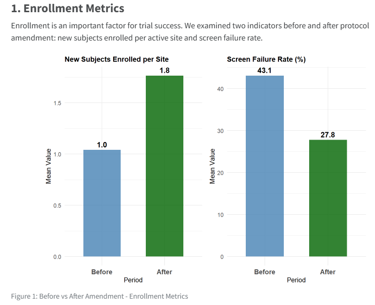
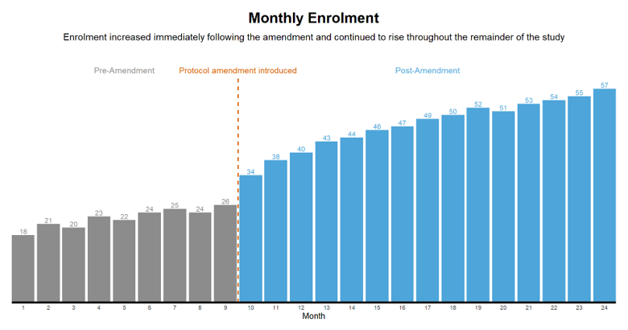

# Protocol Amendment Storytelling
Note: this is the challenge that was set during the July 2026 webinar. There was no webinar in August 2026.

## Background
There is a hypothetical Phase III clinical trial for a chronic disease. During study conduct, recruitment is slower than anticipated. A major protocol amendment is introduced at Month 10 to relax eligibility criteria, reduce visit frequency and simplify data collection requirements.

## The Challenge
The sponsor would like to understand whether the amendment successfully improved trial performance.

Create a data visualisation that clearly communicates any of the following (or any other ‘story’ you find interesting to convey to the sponsor):

- What changed after the amendment
- Whether recruitment improved
- Whether operational efficiency improved
- Any trade-offs or unintended consequences

## The Data
24 months of study conduct (amendment introduced at Month 10). The dataset includes the following variables:

| **Variable Name**        | **Variable Label**                                               |
|--------------------------|------------------------------------------------------------------|
| Month                    | Study month (1-24)                                               |
| Amendment_Status         | Before/After Amendment (indicator)                               |
| New_Subjects_Enrolled    | Number of subjects enrolled during the month                     |
| Screen_Failure_Rate      | Percentage of screened subjects failing eligibility criteria     |
| Active_Sites             | Number of sites actively recruiting                              |
| Protocol_Deviations      | Number of protocol deviations recorded                           |
| Avg_Query_Days           | Average time (days) to resolve data queries                      |
| Avg_Visit_Burden         | Mean scheduled visits per patient                                |
| Retention_Rate           | Percentage of randomised subjects remaining in follow-up         |
| Monitoring_Cost_GBP      | Estimated monitoring expenditure (£)                             |


## Visualisations

<a id="example1"></a>

### Submission 1: Sponsor Report
Submission 1 is a full sponsor report. Hence, it is best viewed via the HTML file.

 

View the HTML file: [Sponsor Report](./Impact of Protocol Amendment - Sponsor Report.html)

[link to code](#example1 code) 


<a id="example2"></a>

### Submission 2: Bar Chart

  

[link to code](#example2 code)


## Code

<a id="example1 code"></a>

### Code for Submission 1

```{r, echo = TRUE, eval=FALSE, code = readLines("./code/Protocol_Amendment_Analysis - Barbara Maas.qmd")}

```

<a id="example2 code"></a>

### Code for Submission 2

```{r, echo = TRUE, eval=FALSE, code = readLines("./code/RWA WWW September 2026.R")}

```

[Back to blog](#example1)