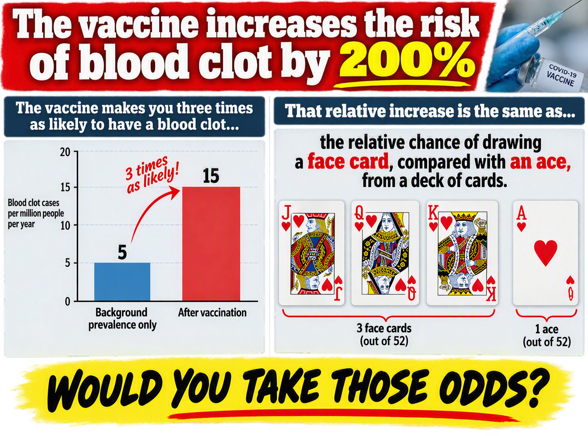
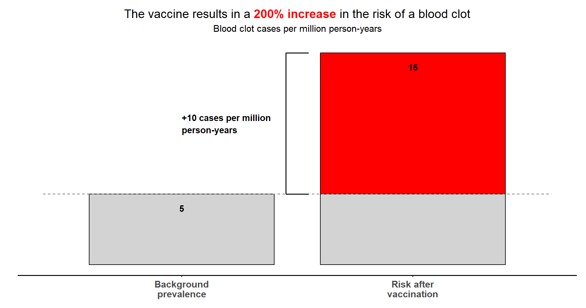
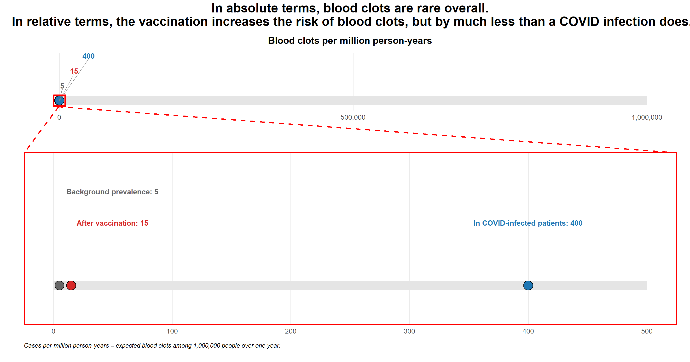
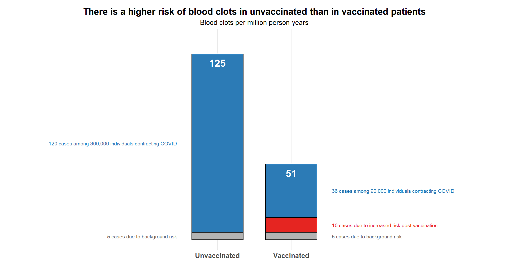

# Vaccine Safety

## Background
Cerebral venous sinus thrombosis (CVST) is a rare type of blood clot. In the early days of COVID vaccine development, there was concern of an increase in blood clot prevalence attributable to the vaccine.

Some assumptions:

- Background CVST prevalence: 5 cases per million person-years
- CVST attributable to vaccine: 10 additional cases per million person-years

## Challenge #1
You are a journalist working on a tabloid newspaper. Produce an eye-catching and dramatic visualisation emphasising the dangers of vaccination, based on relative risk (200% increase in blood clot risk!).

## Challenge #2
You work for a medical communications agency, educating healthcare providers and the public on vaccine benefits and risks. Produce an alternative visualisation showing CVST risk of the vaccine on an absolute scale e.g. comparing absolute risks or number needed to harm (NNH).

Do you draw a different conclusion?

Some more assumptions:

- COVID infection rate (without vaccine protection): 30%
- CVST prevalence in COVID-infected patients: 400 cases*
- Vaccine effectiveness: 70%

## Challenge #3
Produce a visualisation communicating the true risk of CVST. Compare CVST prevalence in vaccinated patients (approx. 46 cases) to unvaccinated patients (approx. 120 cases), after accounting for the CVST rate in COVID patients.

## Challenge #4 (Bonus)
Produce a visualisation from a tipping point analysis: What is the minimum vaccine side effect (CVST additional cases attributable to the vaccine*) at which point the vaccine is worse than unvaccinated patients?

’* Per million person-years


## Visualisations

<a id="example1"></a>

### Submission 1, Challenge 1

  


<a id="example2"></a>

### Submission 2, Challenge 1

  

[link to code](#example2 code)


<a id="example3"></a>

### Submission 2, Challenge 2/3

  

[link to code](#example3 code)


<a id="example4"></a>

### Submission 2, Challenge 3

  

[link to code](#example4 code)


## Code

<a id="example2 code"></a>

### Code for Submission 2, Challenge 1

```{r, echo = TRUE, eval=FALSE, code = readLines("./code/Challenge #1.R")}

```

<a id="example3 code"></a>

### Code for Submission 2, Challenge 2/3

```{r, echo = TRUE, eval=FALSE, code = readLines("./code/Challenge #2 v2.R")}

```

<a id="example4 code"></a>

### Code for Submission 2, Challenge 3

```{r, echo = TRUE, eval=FALSE, code = readLines("./code/Challenge #3 v2.R")}

```

[Back to blog](#example1)