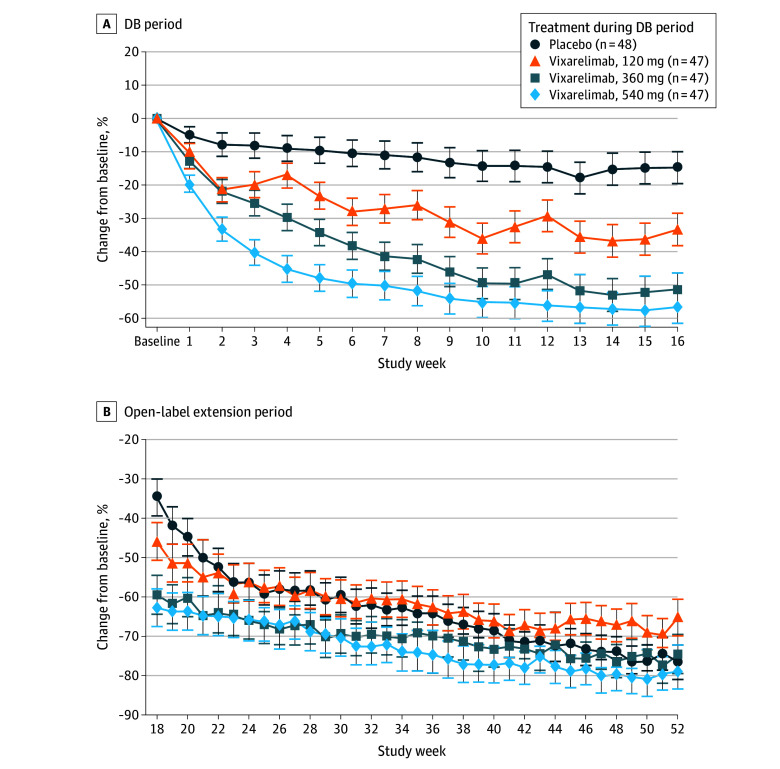
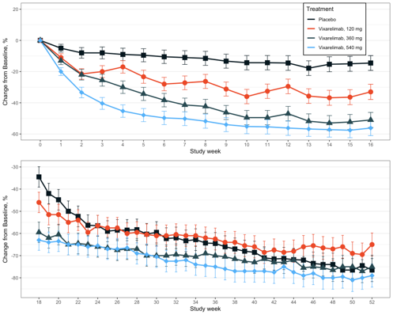
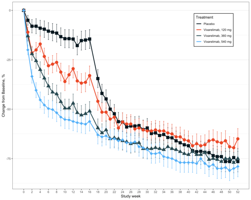
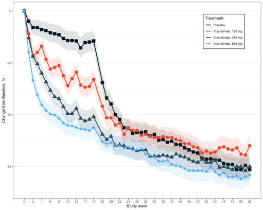
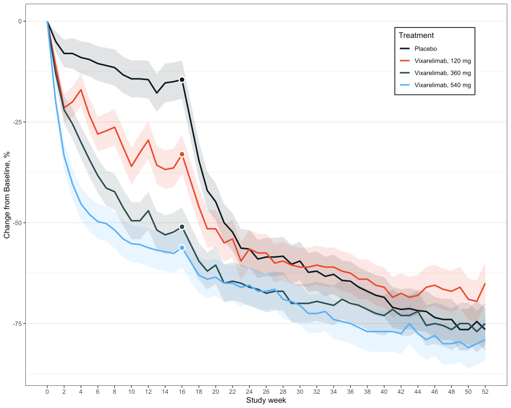
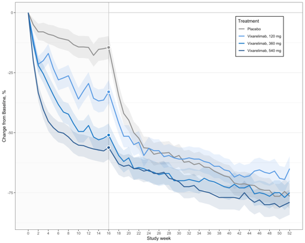
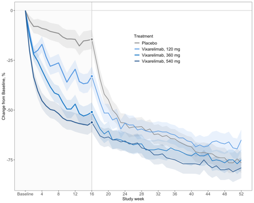
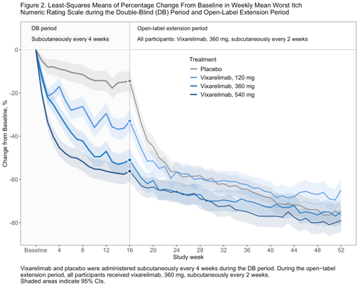
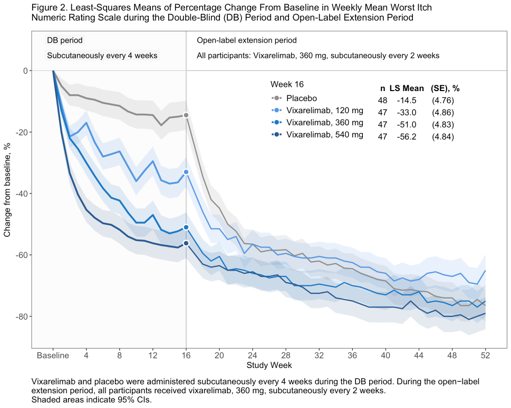

# Prurigo Nodularis

## Background
In the recent publication [**“Vixarelimab in Patients With Prurigo Nodularis: A Randomized Clinical Trial”**](https://pubmed.ncbi.nlm.nih.gov/41405882/) (DOI: 10.1001/jamadermatol.2025.4950) the study results were presented using the following plot:

**Figure 2. Least-Squares Means of Percentage Change From Baseline in Weekly Mean Worst Itch Numeric Rating Scale during the Double-Blind (DB) Period and Open-Label Extension Period**
  
Footnote: Patients who received placebo in the DB period received vixarelimab, 360 mg, subcutaneously once every 2 weeks during the open-label extension period. Error bars indicate 95% CIs.

Importance: Prurigo nodularis (PN) is a chronic inflammatory skin disease characterized by severe pruritus and nodule formation, significantly affecting patients’ quality of life. There is an unmet need for effective therapies to address both symptoms and disease progression.

## Challenge

Observe the plot and evaluate the design decisions made. Check what graphical principles can be used to improve the plot. Ask yourself: What is the main message? And how can this be visually supported?

## Visualisations
One submission was received for this challenge. During the webinar, step-by-step improvements moving from the original visualisation to the final submission were presented and discussed. Each step is presented below, along with notes on what is changed each time.

<a id="example1"></a>

### Rebuild of the original visualisation
- The original visualisation is recreated using simulated data

  

<a id="example2"></a>

### Simplify by combining plots
- Reduce cognitive load

  

<a id="example3"></a>

### Eliminate clutter - add clarity
- Shaded bands instead of error bars

  

<a id="example4"></a>

### Eliminate clutter - focus attention
- Remove markers except for Week 16
- White outline

  

<a id="example5"></a>

### Colour shading
- Reduce cognitive load
- Placebo in grey
- Doses in shades of blue
- Grey line at Week 16
- Area shading

  

<a id="example6"></a>

### Eliminate clutter - clarity and focus
- Open-label lines thinner and slightly greyed
- Fewer x-axis tick marks
- Grid lines removed

  

<a id="example7"></a>

### Information
- Title, footnotes and area labels

  

<a id="example8"></a>

### Additional details (Final submission)
- Table with additional information

  

[link to code](#example8 code)

## Code

<a id="example8 code"></a>

```{r, echo = TRUE, eval=FALSE, code = readLines("./code/Wonderful_Wednesday_Nov_extended.R")}

```

[Back to blog](#example1)